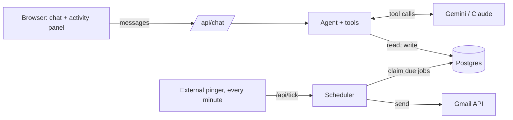

# Outreach Agent

Schedule outreach emails by talking to an AI agent. Describe the email in plain English, review a preview, approve it, and it goes out from your own Gmail at exactly the right time.

> "Email sarah@acme.com tomorrow at 10am about the contract, cc priya@initech.com and bcc me"
>
> "Send rahul@globex.io a pricing follow-up at 9am his time, he's in London"
>
> "What's going out this week?" · "Push the Sarah email to Thursday 2pm" · "Cancel everything to Acme"

**Live demo:** https://outreach-agent-six-bice.vercel.app
(Google sign-in is limited to approved test accounts while the OAuth app is in testing mode. Ask to be added, or see the screenshots and demo video.)

<!--
Screenshots: add the images to docs/screenshots/ and uncomment.

| Draft and approve | Edit before sending | Scheduled and sent |
| --- | --- | --- |
|  |  |  |
-->

## What it does

- **Talk to it.** A chat agent understands who to email, what to say, and when. It drafts the subject and body, looks up contacts, and handles Cc/Bcc.
- **You stay in control.** Nothing is scheduled, changed or cancelled until you click **Approve** on a preview card. You can **Edit** the draft first (recipients, subject, body), and your exact wording is what gets sent.
- **Real times, real timezones.** "In 2 hours", "next Friday at 4", "9am London time" all resolve to an exact moment. The card shows both your time and the recipient's.
- **Manage by chat or by click.** List, reschedule, edit and cancel emails in plain English, or from the activity panel next to the chat.
- **Reliable sending.** A scheduler sends each email once, on time, from your Gmail account, with retries and clear failure messages.

## How it works



The system is two loops around one database:

1. **The agent loop** turns a sentence into a draft. The model picks tools (`find_contacts`, `save_contact`, `schedule_email`, `list_scheduled`, `update_scheduled`, `cancel_scheduled`). The three that change anything pause for approval.
2. **The scheduler loop** runs every minute, claims emails whose time has come, and sends them through Gmail. Sending never happens inside a chat request.

### Design decisions worth knowing

- **Approval is enforced on the server.** The three write tools use the AI SDK's `toolApproval`, and approvals are HMAC-signed, so a client can't forge one. The model can only *propose*.
- **The model never does time maths.** It returns a local wall-clock time plus an IANA timezone; the server converts with Luxon. It rejects daylight-saving gaps, past times and dates more than a year out, so the model can't schedule something impossible.
- **Exactly-once sending.** Due emails are claimed with `UPDATE … WHERE id IN (SELECT … FOR UPDATE SKIP LOCKED)`, so concurrent scheduler runs can never send the same email twice. (Tested with 4 simultaneous runs over 20 emails: 20 sent, no duplicates.)
- **Failures are honest.** Up to 3 attempts (retrying after 1 minute, then 5), then `failed` with the reason shown in the UI. An email stuck mid-send is marked failed rather than risking a duplicate. An email more than 24 hours late is failed, not sent out of the blue. A hard cap of 50 sends a day limits the damage from a mistake.
- **Your edits are applied exactly.** When you edit a draft, the server substitutes your fields when the approved call runs, so the model can't paraphrase them.
- **Late approvals just work.** If a draft's time passes while you're reviewing it, it is sent right away (within 6 hours) and the agent tells you.
- **Interrupted chats recover.** If a reply is cut off (refresh, dropped connection), saved conversations are cleaned on load so one bad message can't lock the chat.
- **Security.** Google refresh tokens are encrypted at rest (AES-256-GCM), only the `gmail.send` permission is requested (the app can't read your inbox), session cookies are signed and HTTP-only, and email headers are protected against injection.

## Tech stack

| Layer | Choice |
| --- | --- |
| App | Next.js 16 (App Router), React 19, Tailwind CSS 4 |
| Agent | Vercel AI SDK 7 (`ToolLoopAgent`, tool approval, `useChat`) |
| Model | Gemini (`gemini-3.5-flash`) when a Google AI key is set, otherwise Claude via Vercel AI Gateway |
| Database | PostgreSQL (Neon in production) with Drizzle ORM |
| Email | Gmail API over Google OAuth |
| Time | Luxon |
| Hosting | Vercel |

## Run it locally

You need Node 22+, pnpm and a local PostgreSQL.

```bash
pnpm install
cp .env.example .env.local        # then fill it in (see below)
createdb email_scheduler
pnpm db:push                       # creates the tables
pnpm dev                           # http://localhost:3100
```

For local development without Google, set `EMAIL_TRANSPORT=log` in `.env.local` and use **Dev sign-in** on the login page. Emails are printed to the server log instead of being sent. To run the scheduler locally, in a second terminal:

```bash
pnpm tick                          # calls /api/tick every 30 seconds
```

### Environment variables

| Variable | Purpose |
| --- | --- |
| `DATABASE_URL` | Postgres connection string |
| `GOOGLE_GENERATIVE_AI_API_KEY` | Gemini key (preferred). Otherwise set `AI_GATEWAY_API_KEY` |
| `GOOGLE_CLIENT_ID`, `GOOGLE_CLIENT_SECRET` | Google OAuth client (for sign-in and Gmail sending) |
| `SESSION_SECRET`, `TOKEN_ENCRYPTION_KEY`, `TOOL_APPROVAL_SECRET`, `CRON_SECRET` | Random secrets: `openssl rand -base64 32` each |
| `APP_URL` | Optional: force the OAuth redirect origin |
| `ALLOWED_EMAILS` | Optional: comma-separated emails allowed to sign in |
| `EMAIL_TRANSPORT` | `log` (development only) prints emails instead of sending |
| `AGENT_MODEL` | Optional: override the model id |

### Google OAuth setup (about 10 minutes)

1. In Google Cloud Console, create a project and enable the **Gmail API**.
2. Configure the OAuth consent screen: **External**, **Testing**, and add yourself (and anyone who should try it) as a **test user**.
3. Create an **OAuth client ID** of type **Web application** with these redirect URIs:
   - `http://localhost:3100/api/auth/google/callback`
   - `https://<your-domain>/api/auth/google/callback`
4. Put the client ID and secret in your environment.

Note: Google signs users out of apps in Testing mode after 7 days. If an email fails with "Gmail access was revoked or expired", sign in with Google again.

## Deploy

1. Push to GitHub and import the repo in **Vercel**.
2. Add a **Neon** database from the Vercel Marketplace (adds `DATABASE_URL`).
3. Create the tables: run [`scripts/schema.sql`](scripts/schema.sql) in the Neon SQL editor. (Upgrading an existing database? Run the files in [`scripts/migrations/`](scripts/migrations).)
4. Set the environment variables above in Vercel and redeploy.
5. Add the production redirect URI to the Google OAuth client.
6. **Set up the scheduler pinger.** Vercel's Hobby plan only allows daily crons, so use a free external pinger such as [cron-job.org](https://cron-job.org): `GET https://<your-domain>/api/tick` every 1 minute with the header `Authorization: Bearer <CRON_SECRET>`. (On Vercel Pro you can use a native per-minute cron instead.) Without this, nothing is ever sent.

## Project layout

```
src/agent/        the agent: tools, approval rules, system prompt
src/lib/          emails (service layer), sender (scheduler), time, Gmail client, recipients, crypto
src/app/api/      chat, jobs, tick (scheduler), Google auth
src/components/   chat UI, approval cards, editor, activity panel
src/db/           Drizzle schema
scripts/          schema.sql, migrations, local ticker
```

## Limitations and what's next

Plain-text emails only (no attachments or HTML). Delivery failures such as bounces aren't detected, and replies aren't read. There is no automated test suite yet: behaviour was verified by hand against the real Gmail API and with concurrency tests on the scheduler.

Next up:

- **Follow-up sequences** with automatic stop when the lead replies
- **Personalised drafts** from a per-lead note
- An **MCP server** exposing the same tools to other AI agents
- Send windows in the recipient's business hours
